# 🛡️ Awesome Ransomware Intelligence & Decryption Analysis 🔓

**A curated index of Cyber Threat Intelligence (CTI) platforms, open-source decryptors, Dark Web leak trackers, and reverse engineering tools for ransomware mitigation and data recovery.**

  
  
  
  
  
  
  

*Last updated: November 2026*

---

## 📖 Table of Contents

- [📌 Introduction & Overview](#-introduction--overview)
- [📊 Sector Overview & Market Dynamics](#-sector-overview--market-dynamics)
- [🏢 SaaS & Hosted Enterprise Platforms](#-saas--hosted-enterprise-platforms)
- [💻 Open-Source GitHub Projects](#-open-source-github-projects)
  - [🗂️ Threat Intelligence & Dark Web Trackers](#️-threat-intelligence--dark-web-trackers)
  - [🔑 Decryption Toolkits & Memory Rescue](#-decryption-toolkits--memory-rescue)
  - [📚 Curated Decryptor Archives & Portals](#-curated-decryptor-archives--portals)
- [🌐 Notable Vendor Decryptor Portals](#-notable-vendor-decryptor-portals)
- [🤝 How to Contribute](#-how-to-contribute)
- [⭐ Star History](#-star-history)
- [💖 Support & Sponsorship](#-support--sponsorship)
- [⚠️ Disclaimer](#️-disclaimer)

---

## 📌 Introduction & Overview

Welcome to the **Ransomware Intelligence & Decryption Analysis** curated repository. Ransomware incidents remain the costliest cybersecurity emergency confronting modern enterprises, healthcare providers, and critical infrastructure. 

This repository provides an authoritative, structured directory of:
- **Enterprise Cyber Threat Intelligence (CTI) & Defense Platforms**: Commercial solutions providing real-time telemetry, automated memory rollback, dark web extortion site monitoring, and negotiation assistance.
- **Strain-Specific Open-Source Decryption Toolkits**: Verified community implementations that exploit cryptographic weaknesses (e.g. Salsa20 keystream reuse in LockBit 3.0, memory dump session key harvesting, weak pseudo-random number generators).
- **Dark Web Extortion Trackers & Feeds**: Scrapers and feeds monitoring Ransomware-as-a-Service (RaaS) leak portals and cryptocurrency transaction trails.

> 💡 **Open-source note**: While commercial tools excel at enterprise-wide dark web monitoring and continuous EDR telemetry, open-source tools remain the lifeline for independent decryption analysis and zero-cost file recovery when specific conditions (such as offline keys or memory dumps) are met.

---

## 📊 Sector Overview & Market Dynamics

The global **Cyber Threat Intelligence (CTI)** and **Ransomware Defense** market is estimated at **$18.4 billion to $20.1 billion** in 2025–2026, growing at a rapid **14.5% to 15.7% CAGR**, while the broader ransomware protection, immutable storage, and mitigation sector exceeds **$32.0 billion**. 

The sector displays a **moderately fragmented** competitive dynamic:
- **Consolidated Foundations**: Core endpoint telemetry, initial detection, and global attack surface surveillance are heavily concentrated among massive security conglomerates and publicly traded vendors (**CrowdStrike**, **Google/Mandiant**, **Sophos**).
- **Specialized Niche Agility**: High-stakes extortion mediation, specialized dark web reconnaissance, live memory extraction, and bespoke cryptographic reversing are driven by dedicated specialists (**Halcyon**, **Coveware by Veeam**, **Flashpoint**, **Recorded Future**).

---

## 🏢 SaaS & Hosted Enterprise Platforms

The table below lists leading commercial SaaS platforms and enterprise incident services, ranked in descending order by **company size / valuation**:

| Platform | Company Size (Valuation / Revenue) | Pricing (Specific Starting Tier) | Free Tier Limits / Free Trial | Key Capabilities & Highlights |
| :--- | :--- | :--- | :--- | :--- |
| **[Mandiant Threat Intelligence](https://www.mandiant.com/)** | **~$2.1T Market Cap** (Parent: Alphabet / Google Cloud; Mandiant acquired for $5.4B) | **$83,000/year** baseline enterprise contract benchmark (or Google Cloud Unified Security ingestion commitments) | **Permanent free tier** for Mandiant Advantage (select threat actors, malware families, IOCs & vulnerability feeds) + **14-day trial** of advanced features | 🔍 Frontline intelligence derived from global incident response investigations; tracks adversary groups, initial access brokers (IABs), and active ransomware campaign telemetry. |
| **[CrowdStrike Falcon](https://www.crowdstrike.com/)** | **~$75B Market Cap** (~$3.9B ARR) | **$59.99/device/year** (Falcon Go tier; min 5 devices) or $99.99/device/year (Falcon Pro) | **15-day free trial** with full access to Falcon Prevent NGAV and USB device control (no credit card required) | 🦅 Combines Falcon Sandbox automated malware detonation with threat scoring, behavioral ransomware blocking, and IOC extraction for ransomware family triage. |
| **[Sophos Ransomware Protection](https://www.sophos.com/)** | **~$3.9B Valuation** (Acquired by Thoma Bravo; ~$1.1B ARR) | **$50.00/user/year** (Intercept X Advanced starting tier through authorized reseller channels) | **30-day free trial** with full access to Intercept X Advanced and CryptoGuard protection for up to 100 endpoints | 🛡️ Intercept X featuring CryptoGuard anti-ransomware technology; monitors malicious file encryption, kills suspect processes, and rolls back modified documents. |
| **[Trend Micro Ransomware File Decryptor](https://success.trendmicro.com/)** | **~$6.5B Market Cap** (~$1.7B ARR) | **$0.00** (100% free standalone utility provided for public victim recovery) | **Unlimited free forever**; standalone tool with no device limits or registration required | 🔓 Free decryption utility targeting specific legacy ransomware families (TeslaCrypt V1/V2, CryptXXX, LeChiffre, DXXD, Teamxrat, Crysis, WannaCry, Petya). |
| **[Bitdefender Ransomware Remediation](https://www.bitdefender.com/)** | **~$2.0B Valuation** (~$350M ARR) | **$38.50/device/year** (GravityZone Business Security starting tier, 10 devices minimum = $385/year) | **30-day free trial** for GravityZone Business Security (full capabilities for up to 50 endpoints, no credit card required) | 🔄 GravityZone Ransomware Mitigation monitors real-time disk entropy; creates local in-memory shadow copies and restores encrypted files immediately upon process termination. |
| **[Recorded Future](https://www.recordedfuture.com/)** | **~$1.5B Valuation** (Acquired by Mastercard for $2.65B; ~$300M ARR) | **$40,000/year** (Core Intelligence package starting tier with single module & capped API volume) | **30-day free trial** for SIEM/SOAR integrations (Splunk/Sentinel); free browser extension (*Recorded Future Express*) for on-demand IOC lookups | 🌐 Real-time dark web extortion portal monitoring, victimology dashboards, affiliate threat actor tracking, and automated SecOps remediation workflows. |
| **[Halcyon](https://www.halcyon.ai/)** | **~$1.0B Valuation** (Series C unicorn; ~$79.5M ARR estimate) | **$50.00/endpoint/year** enterprise benchmark (e.g. $100,000/year volume block on AWS Marketplace; custom quote) | **30-day partner Proof of Concept (POC)** / evaluation license arranged via sales or authorized MSSP partners | ⚡ Dedicated anti-ransomware endpoint resilient agent with automated cryptographic key capture, Salsa20/AES payload interception, and 24/7 Ransomware Operations Center (ROC). |
| **[Flashpoint](https://flashpoint.io/)** | **~$500M Valuation** (~$107M ARR) | **$15,000/year** (£12,150/year base G-Cloud framework starting tier for Flashpoint Ignite) | **21-day to 30-day free trial** (structured proof of concept available on request for vetted security teams) | 🕵️ Deep dark web intelligence tracking illicit communities, extortion negotiations, Ransomware-as-a-Service (RaaS) affiliate programs, and leaked credentials. |
| **[Malwarebytes Threat Intelligence](https://www.malwarebytes.com/)** | **~$350M Valuation** (~$150M ARR) | **$69.00/endpoint/year** (ThreatDown Endpoint Protection starting tier for business fleets) | **14-day free trial** for Windows premium business agents; full scan/detection testing without upfront payment | 🧰 ThreatDown engine delivering behavioral anti-ransomware mitigation, payload detonation, automated quarantine, and IOC feeds from global telemetry. |
| **[Coveware by Veeam](https://www.coveware.com/)** | **~$100M Valuation** (Acquired by Veeam; Veeam generates ~$1.5B ARR) | **$25,000 baseline retainer** for proactive Cyber Extortion Readiness & Response (or scoped project fees per incident) | **No free trial** (specialized reactive IR and extortion mediation engagement governed by incident SOW) | 🤝 Comprehensive ransomware incident response, cryptocurrency negotiation logistics, decryptor integrity verification, and recovery settlement decision trees. |

---

## 💻 Open-Source GitHub Projects

Curated open-source intelligence trackers, decryptor archives, threat matrix databases, and memory recovery frameworks, strictly ordered by **GitHub Star Count (descending)**:

| Project | Stars | Focus Area | Description & Direct Links |
| :--- | :--- | :--- | :--- |
| **[BushidoUK/Ransomware-Tool-Matrix](https://github.com/BushidoUK/Ransomware-Tool-Matrix)** |  | 🧠 Ransomware Intelligence | Comprehensive intelligence database mapping software tooling, LOLBAS binaries, and exfiltration scripts utilized by every major ransomware gang. |
| **[alvin-tosh/Malware-Exhibit](https://github.com/alvin-tosh/Malware-Exhibit)** |  | 🔬 Malware & Ransomware Analysis | Curated educational repository of real-world malware and ransomware analysis reports, mitigation strategies, and threat behavioral breakdowns. |
| **[joshhighet/ransomwatch](https://github.com/joshhighet/ransomwatch)** |  | 📡 Threat Intelligence & Tracking | Automated scraper and real-time monitoring pipeline tracking Tor dark web extortion sites and victim claim updates across 100+ ransomware syndicates. |
| **[Neo23x0/Raccine](https://github.com/Neo23x0/Raccine)** |  | 💉 Ransomware Mitigation | A lightweight vaccine tool that intercepts and blocks suspicious `vssadmin` shadow copy deletions used by ransomware during initial infection stages. |
| **[RansomLook/RansomLook](https://github.com/RansomLook/RansomLook)** |  | 🌐 Dark Web Intelligence | Open-source ransomware group intelligence tracker that indexes leaks, announcements, and negotiations published across criminal dark web leak portals. |
| **[badchars/darknet-mcp-server](https://github.com/badchars/darknet-mcp-server)** |  | 🤖 MCP Intelligence Server | Model Context Protocol (MCP) server providing 66 integrated tools for dark web reconnaissance, ransomware payment tracking, Tor onion access, and stealer log auditing. |
| **[cert-orangecyberdefense/ransomware_map](https://github.com/cert-orangecyberdefense/ransomware_map)** |  | 🗺️ Threat Telemetry & Mapping | Global cyber defense mapping framework tracking operational ransomware trends, sector impacts, and geographical distributions across continents. |
| **[vxunderground/ThreatIntelligenceDiscordBot](https://github.com/vxunderground/ThreatIntelligenceDiscordBot)** |  | 💬 Threat Intelligence Feeds | Automated threat intelligence bot relaying updates from cybersecurity domains, ransomware leak portals, and malware repositories directly to analyst teams. |
| **[JMousqueton/ransomware.live](https://github.com/JMousqueton/ransomware.live)** |  | 📈 Ransomware Activity Tracking | Open-source backend tracking ransomware groups, negotiations, victim announcements, and data breach leak sites with automated JSON and RSS feeds. |
| **[aryanguenthner/darkfox](https://github.com/aryanguenthner/darkfox)** |  | 🦊 OSINT & Threat Reconnaissance | CTI and dark web OSINT intelligence tool that automates threat actor reconnaissance, gang activity parsing, and infrastructure profiling. |
| **[saddytech/lockbit-rescue](https://github.com/saddytech/lockbit-rescue)** |  | 🗝️ Decryption Toolkit | Decryption toolkit exploiting a keystream-reuse vulnerability in LockBit 3.0 ("Black") to reconstruct Salsa20 keystreams using known long filename plaintext. |
| **[ThreatLabz/tools](https://github.com/ThreatLabz/tools)** |  | 🛠️ Decryption & Analysis Scripts | Security tools and custom decoders developed by Zscaler ThreatLabz for analyzing ransomware configurations and extracting decryptor keys. |
| **[cablej/ransomwhere](https://github.com/cablej/ransomwhere)** |  | 💰 Payment Tracking | Crowdsourced platform tracking bitcoin ransomware extortion transactions and ransomware gang cryptocurrency wallet addresses. |
| **[DecryptoniteTeam/Decryptonite](https://github.com/DecryptoniteTeam/Decryptonite)** |  | 🛡️ Decryption & Defense | Open-source ransomware detection and mitigation software featuring file recovery mechanisms and real-time encryption monitoring. |
| **[curated-intel/MOVEit-Transfer](https://github.com/curated-intel/MOVEit-Transfer)** |  | 📑 Campaign Intelligence | Curated threat intelligence repository tracking extortion campaigns, IOCs, and affected entities tied to the Cl0p ransomware operation. |
| **[jamestiotio/NoMoreRansom](https://github.com/jamestiotio/NoMoreRansom)** |  | 📦 Decryptor Archive | All-in-one unofficial mirror repository providing standalone executable decryptors from the No More Ransom public project. |
| **[cycraft-corp/Prometheus-Decryptor](https://github.com/cycraft-corp/Prometheus-Decryptor)** |  | 🔓 Decryption Toolkit | Dedicated open-source decryption utility recovering files affected by the Prometheus ransomware strain without paying extortions. |
| **[f6-dfir/Ransomware](https://github.com/f6-dfir/Ransomware)** |  | 📋 DFIR Threat Knowledgebase | Structured, continuously updated incident response database documenting ransomware families, execution methods, and mitigation tactics. |
| **[califio/lockbit-v3-linux-decryptor](https://github.com/califio/lockbit-v3-linux-decryptor)** |  | 🐧 Decryption Toolkit | Core C reference implementation (`stream-reuse.c`) demonstrating keystream extraction for Linux systems infected by LockBit 3.0. |
| **[mstfknn/ransomware-decryptors](https://github.com/mstfknn/ransomware-decryptors)** |  | 📂 Decryptor Directory | Curated repository collecting verified free ransomware decryptor binaries, execution instructions, and key restoration tools. |
| **[RedDrip7/WannaRen_decryptor](https://github.com/RedDrip7/WannaRen_decryptor)** |  | 🇨🇳 Decryption Toolkit | Decryption tool created by the RedDrip Team to recover files encrypted by the WannaRen ransomware variant using leaked private keys. |
| **[hasherezade/decryptors_archive](https://github.com/hasherezade/decryptors_archive)** |  | 🗄️ Decryptor Archive | Comprehensive historical archive of ransomware decryptors and security research utilities maintained by security researcher hasherezade. |
| **[cyberiskvision/dls-monitor](https://github.com/cyberiskvision/dls-monitor)** |  | 🕵️ Dark Web Scraper | Intelligence scanner monitoring public ransomware Data Leak Sites (DLS) to alert on corporate victims and track extortion timelines. |
| **[Bedrock-Safeguard/gentlemen-decryptor](https://github.com/Bedrock-Safeguard/gentlemen-decryptor)** |  | 🎩 Memory Recovery Toolkit | Cryptographic tool that extracts X25519 ephemeral private encryption keys directly from volatile memory dumps to achieve full file recovery. |
| **[Benjamin-zlt/c3rb3r-baremetal-rescue](https://github.com/Benjamin-zlt/c3rb3r-baremetal-rescue)** |  | 💾 Live Memory Decryption | Bare-metal rescue script for Synology NAS infected by C3RB3R ransomware; freezes encryptor process, dumps RAM, and extracts session keys. |
| **[JavierYuste/AvaddonDecryptor](https://github.com/JavierYuste/AvaddonDecryptor)** |  | 🔓 Decryption Utility | Dedicated decryptor utility designed to restore local file systems infected by the Avaddon ransomware strain. |
| **[depalmar/AI-Powered-Ransomware-Intelligence-Agent](https://github.com/depalmar/AI-Powered-Ransomware-Intelligence-Agent)** |  | 🤖 AI Threat Agent | Automated workflow integrating ransomware.live APIs and LLM analysis to monitor syndicate announcements and generate real-time briefings. |
| **[formfactor1/Ransomware-Encryptor-Decryptor](https://github.com/formfactor1/Ransomware-Encryptor-Decryptor)** |  | 🧪 Analysis & Emulation | PowerShell-based ransomware simulation and symmetric decryption toolkit designed for incident response training and decryptor validation. |
| **[robacarp/nemucod_decrypt](https://github.com/robacarp/nemucod_decrypt)** |  | 💎 Decryption Utility | Ruby utility that reverses XOR/symmetric payloads deployed by Nemucod-family ransomware droppers. |
| **[alternat0r/Ransomware-Decryptor-List](https://github.com/alternat0r/Ransomware-Decryptor-List)** |  | 📑 Decryptor Directory | Broad reference directory documenting verified decryption tools across dozens of ransomware variants and threat groups. |
| **[wikijm/ransomware-decryptiontool-list](https://github.com/wikijm/ransomware-decryptiontool-list)** |  | 📑 Decryptor Directory | Curated directory indexing public ransomware decryptors released by security researchers, police agencies, and antivirus providers. |

---

## 🌐 Notable Vendor Decryptor Portals

- 🛡️ **[No More Ransom](https://www.nomoreransom.org/)** — Flagship international initiative by Europol, Dutch Police, and cybersecurity partners hosting 150+ free decryptors covering 165+ ransomware families. Features **Crypto Sheriff** for identifying unknown strains from ransom notes and sample files.
- 🇷🇺 **[No Ransom (Kaspersky)](https://noransom.kaspersky.com/)** — Comprehensive free decryptor library including **RakhniDecryptor** (covers TeslaCrypt, Dharma, Crysis, Conti), **RannohDecryptor**, and **YanluowangDecryptor**.
- 🇨🇿 **[Avast Free Ransomware Decryption Tools](https://www.avast.com/ransomware-decryption-tools)** — Repository of verified decryptors covering HermeticRansom, Babuk, AtomSilo, BadBlock, and Jigsaw.
- 🇳🇿 **[Emsisoft Decryptor Portal](https://www.emsisoft.com/ransomware-decryption-tools/)** — Industry standard decryption utilities for the pervasive **STOP/Djvu** family (offline key variants) and dozens of other strains.

---

## 🤝 How to Contribute

Contributions from threat intelligence analysts, reverse engineers, and security teams are warmly welcomed!

1. 🍴 **Fork** this repository.
2. 🌿 Create a branch for your addition (`git checkout -b feat/add-new-tool`).
3. 📝 Update `README.md` following the existing tabular structure:
   - For **SaaS**: include specific starting tier pricing, free tier / trial limits, and company size metrics.
   - For **Open-Source**: include the white social star badge linked to `/stargazers`.
4. 🚀 Open a **Pull Request** detailing the functionality, tool type, and verification links.

---

##  Star History

---

## 💖 Support & Sponsorship

Thank you for visiting and using this resource! If you find this curated collection valuable for your security research, threat hunting, or incident recovery workflows:

- ⭐ **Star this repository** to help others discover it across GitHub.
- 🍴 **Fork and share** with colleagues, SOC teams, and the security community.
- ☕ **Buy a coffee & sponsor**: If this project saved your team time or helped in an incident, consider supporting future maintenance and research via the [GitHub Sponsors Dashboard](https://github.com/sponsors/ishandutta2007).

---

## ⚠️ Disclaimer

- This repository is a community-curated educational and incident recovery reference list.
- Ransomware decryption utilities and memory carving tools must **only** be executed on systems you own or have explicit legal authorization to remediate.
- Always create byte-for-byte forensic disk clones of infected storage media before attempting any recovery or decryption procedures.
- Open-source decryptors are strain-specific and dependent on implementation conditions. Verify digital signatures and file hashes before deploying any binary.

---

  Built with care for threat hunters, DFIR analysts, and organizations fighting cyber extortion worldwide.

